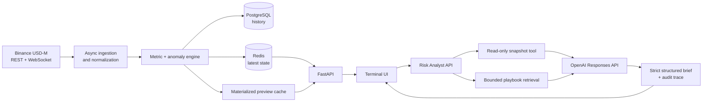

# Quant Desk

AI-assisted crypto risk intelligence for Binance USD-M perpetual futures.

Quant Desk turns noisy market telemetry into a ranked, evidence-backed workspace. It combines sector rotation, open-interest changes, flow proxies, liquidity, liquidations, market structure, and anomaly rules in one terminal-style interface. A bounded AI Risk Analyst can summarize a selected market, but it cannot recommend or execute a trade.

## Why this project exists

Crypto derivatives dashboards often surface hundreds of disconnected metrics. Quant Desk answers a narrower question:

> Which sectors and markets deserve a human analyst's attention right now, and what could invalidate that view?

The product emphasizes:

- sector and pair-level relative strength;
- early anomaly detection rather than retrospective winners;
- explicit data freshness and fallback states;
- evidence-linked AI output with a visible execution boundary;
- resilient degradation when Binance, Redis, PostgreSQL, or OpenAI is unavailable.

## Product capabilities

- **Sector Screener** ranks baskets by price, volume, OI, CVD, liquidation, and participation signals.
- **Outlier Radar** finds pair-level deviations across the full market or inside the selected sector.
- **Outlook Cockpit** exposes the underlying evidence for the selected candidate.
- **AI Risk Analyst** produces a structured `monitor`, `avoid`, or `needs_context` brief.
- **Live ingestion** collects Binance REST snapshots and liquidation WebSocket events.
- **Materialized cache** keeps the UI usable when live providers are unavailable.
- **Audit trace** records model/provider, latency, token usage, tool calls, safety flags, and fallback reason.

## Architecture



## Bounded AI workflow

The Risk Analyst is intentionally decision-support, not an execution agent.

1. The server resolves the requested symbol against its own cached snapshot.
2. The model can call exactly two allow-listed, read-only tools:
   - `get_market_snapshot`
   - `retrieve_risk_playbook`
3. Tool arguments are validated against the approved symbol and horizon.
4. The final response is parsed into a strict Pydantic schema.
5. Server-side safety validation rejects execution language and unknown evidence IDs.
6. Stale data, a missing API key, provider failure, or invalid model output triggers a deterministic fallback.

Every response sets:

```json
{
  "requires_human_review": true,
  "execution_allowed": false
}
```

The model never receives credentials, never writes market state, and has no exchange execution tool.

## Security baseline

Quant Desk is safe by default for localhost evaluation and fails closed around costly operations in production:

- staging and production require `ADMIN_API_KEY` for live universe discovery, ingestion, and AI analysis;
- protected endpoints have a small per-process request budget;
- CORS origins and trusted hosts are explicit;
- CSP, anti-framing, MIME-sniffing, referrer, permissions, and cache headers are set centrally;
- upstream strings are escaped before dynamic HTML insertion;
- provider exceptions are logged internally and normalized in API responses;
- Docker binds the API, Redis, and PostgreSQL to loopback;
- CI runs tests, Ruff, dependency consistency, and frontend syntax validation;
- Dependabot tracks Python and GitHub Actions updates.

The shared admin key is a portfolio safeguard, not a replacement for user authentication. An internet deployment still needs TLS, real identity and authorization, and distributed rate limiting. See [SECURITY.md](SECURITY.md) for the threat model and deployment requirements.

## Technology

| Layer | Stack |
| --- | --- |
| API and agent orchestration | Python, FastAPI, Pydantic, OpenAI Responses API |
| Market ingestion | asyncio, HTTPX, WebSockets |
| State and history | Redis, PostgreSQL, SQLAlchemy |
| Configuration | Pydantic Settings, YAML |
| Frontend | HTML, CSS, vanilla JavaScript |
| Quality | Pytest, Ruff |
| Runtime | Docker Compose |

## Quick start

### Local demo

Python 3.10+ and Node.js are sufficient for the cached-data demo.

```powershell
git clone https://github.com/GarnikSacsha/screneer.git
cd screneer
python -m venv .venv
.\.venv\Scripts\python -m pip install -e ".\backend[dev]"
Copy-Item .env.example .env
.\.venv\Scripts\python -m uvicorn app.main:app --app-dir backend --host 127.0.0.1 --port 8000
```

Open `http://127.0.0.1:8000`.

The Risk Analyst works without an OpenAI key through the deterministic audited fallback. To enable the model-backed path, set `OPENAI_API_KEY` in `.env`. Never commit the key.

For staging or production, set `APP_ENV=production`, replace `POSTGRES_PASSWORD`, configure explicit `ALLOWED_ORIGINS` and `ALLOWED_HOSTS`, and generate a long random `ADMIN_API_KEY`. Protected API clients must send it in `X-Quant-Desk-Key`; never expose that header value in browser code.

### Full stack

```powershell
Copy-Item .env.example .env
docker compose up --build
```

This starts the API, snapshot worker, liquidation stream worker, PostgreSQL, and Redis.

## API surface

| Method | Endpoint | Purpose |
| --- | --- | --- |
| `GET` | `/api/health` | Service health |
| `GET` | `/api/agent/config` | Agent availability and allow-listed tools |
| `POST` | `/api/agent/risk-brief` | Evidence-backed risk brief |
| `GET` | `/api/metrics/latest` | Latest pair metrics |
| `GET` | `/api/sectors/latest` | Latest sector metrics |
| `GET` | `/api/events` | Recent anomaly events |
| `POST` | `/api/ingestion/binance/preview` | Non-persisted live scan |
| `POST` | `/api/ingestion/binance/snapshot` | Persisted snapshot run |

Example:

```powershell
Invoke-RestMethod `
  -Method Post `
  -Uri http://127.0.0.1:8000/api/agent/risk-brief `
  -ContentType application/json `
  -Body '{"symbol":"SOLUSDT","horizon":"intrawick"}'
```

## Verification

```powershell
.\.venv\Scripts\python -m pytest -q
.\.venv\Scripts\python -m ruff check backend
node --check app.js
```

## Design notes and limitations

- CVD is currently a candle-derived proxy; a trade-stream aggregator is the next accuracy upgrade.
- Cached snapshots are marked and rejected by the analyst when older than the configured freshness limit.
- The application has no exchange order endpoint by design.
- Authentication and rate limiting are required before exposing the API beyond a trusted demo environment.
- This project is analytical software, not individualized financial advice.

More detail: [risk analyst architecture](docs/architecture/risk-analyst.md), [requirements](REQ.md), and [metric guide](METRICS.md).
