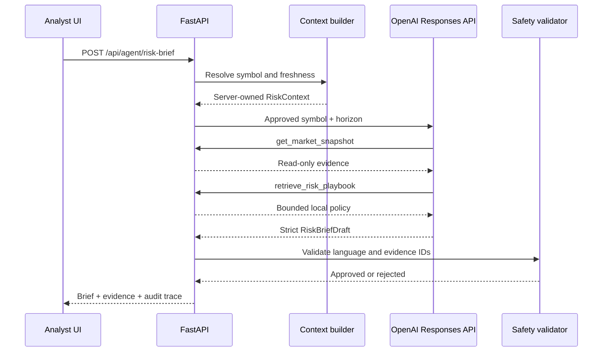

# Risk Analyst Architecture

## Objective

Convert a selected Quant Desk market snapshot into a concise risk brief without granting the model authority to trade, mutate state, or retrieve arbitrary external data.

## Request flow



## Trust boundaries

| Input | Trust level | Enforcement |
| --- | --- | --- |
| Symbol and horizon | Untrusted | Pydantic validation and server-side scope check |
| Cached market snapshot | Data only | Never interpreted as instructions |
| Event messages | Data only | Prompt-injection boundary in system instructions |
| Risk playbook | Controlled local policy | YAML loaded from the configured directory |
| Model output | Untrusted | Strict schema, evidence allow-list, phrase validation |
| OpenAI API key | Secret | `SecretStr`, environment only, never returned |

## Allowed tools

### `get_market_snapshot`

Returns the resolved symbol, sector, freshness, data quality, market metrics, related anomaly events, and stable evidence IDs. It rejects any symbol or horizon outside the approved request.

### `retrieve_risk_playbook`

Runs deterministic lexical retrieval over a local YAML playbook. The result is bounded and cannot access the network or filesystem outside the configured playbook.

## Failure behavior

The deterministic fallback is used when:

- `OPENAI_API_KEY` is not configured;
- the provider times out or returns an error;
- the model skips a required tool;
- structured parsing fails;
- safety validation rejects the draft.

The fallback uses the same `RiskBriefResponse` contract and exposes its reason in `trace.fallback_reason`. A stale or degraded snapshot always returns `needs_context`.

## Observability

Every response includes:

- an application-generated run ID;
- completion or fallback status;
- provider, model, and response ID;
- end-to-end latency;
- input and output token counts when available;
- tool name, status, latency, and result count;
- safety flags and fallback reason.

Structured server logs record the same run-level metadata without secrets or hidden model reasoning.

## Safety invariant

The system is decision-support only:

```text
requires_human_review = true
execution_allowed = false
```

There is no order-placement client or exchange execution endpoint in the application.
